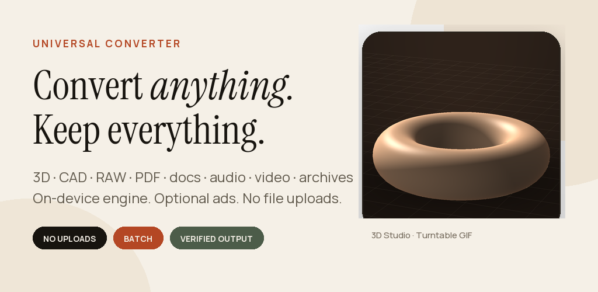

# Universal Converter

A production-oriented Android file studio with a native, on-device conversion engine and optional, clearly disclosed ads and billing. Built with Kotlin, Jetpack Compose and Material 3. No account system and no file uploads.



**Version 1.0.0** · package `com.universalconverter.pro` · minSdk 26 · targetSdk 36 · Android 8.0+

| Release artifact | File |
| --- | --- |
| Google Play bundle | [`release/UniversalConverterPro-1.0.0.aab`](release/UniversalConverterPro-1.0.0.aab) |
| Sideload APK (signed) | [`release/UniversalConverterPro-1.0.0.apk`](release/UniversalConverterPro-1.0.0.apk) |
| R8 mapping for Play | `release/mapping-release.txt` (generated locally, excluded from git due to size) |
| Checksums | [`release/SHA256SUMS.txt`](release/SHA256SUMS.txt) |

The AAB and APK are signed with the local upload key (`keystore/universal-converter.jks`, alias `universalconverter`). Keep `keystore.properties` and the JKS backed up securely and out of public source control. See [Signing](#signing).

---

## Why this app exists

Filee is an MIT-licensed desktop converter. This project adapts its format taxonomy and conversion ideas to a native Android engine rather than running the original C# desktop code on Android. All decoding/encoding is implemented with Android platform APIs, Kotlin codecs and permissively licensed JVM libraries. The Filee MIT notice is included in the app, under `Licenses`, and in [`docs/licenses`](docs/licenses).

The result is a quiet, local tool: every source is copied into a private vault, converted on device, verified, and listed with an auditable X-ray report.

---

## Feature highlights

- **3D Studio** — interactive OpenGL ES 3.0 preview for GLB/glTF/OBJ/STL/PLY/OFF, orbit/pinch gestures, clay/color/wire modes, grid, auto-rotation, model statistics, **print readiness check** (watertightness, manifold edges, degenerate faces, normal direction, volume, shells).
- **Turntable GIF** — renders a dark-studio turntable offline and saves it to the vault, with a shareable result sheet.
- **Smart format detection** — magic bytes + structural checks + text heuristics; warns when an extension lies about the actual content. Default targets are chosen by family.
- **Capability-honest UI** — the device probes available audio/video encoders. Unsupported targets are hidden instead of failing later.
- **Batch queue** — mixed file families can share a batch, each row keeping its own smart target. Sequential foreground queue with live progress, cancellation between stages, cancel-all, retry, and per-output actions.
- **Conversion X-ray** — every success records engine, duration, size, preset, SHA-256, pipeline steps, warnings and a header verification result. Failures get a clear reason too.
- **Vault & file manager** — private inbox/vault, search, family filters, grid, rename, delete, share, Save copy to Downloads (Android 10+), folder browsing, source re-import.
- **Recipes** — Archive, Balanced, Web and Tiny presets with real per-family settings (image edge/quality, audio bitrate, video height/bitrate, GIF width/fps, PDF page size, archive level).
- **Share in / share out** — Android share-sheet target for one or many files; exports are shared through a scoped FileProvider.
- **Offline conversion engine** — conversions never need the network. `INTERNET`/`ACCESS_NETWORK_STATE` exist only for optional AdMob ads and Google Play billing; the engine itself runs in airplane mode.
- **Theme system** — System/Light/Dark, four accent colours (Ember, Sage, Gold, Cobalt), OLED pure-black mode, live theme previews, and a first-run theme picker.
- **Branded startup** — AndroidX SplashScreen plus a branded in-app splash, followed by a three-page welcome tour (formats, 3D studio, theme/privacy).
- **Optional monetisation** — Google AdMob banner above the app navigation (never over the Android system buttons), a frequency-capped interstitial after completed conversions, an opt-in rewarded 24-hour ad-free pass, and a one-time US$4.99 Remove Ads product through Google Play Billing.
- **Complete settings** — appearance, defaults, workflow, storage, privacy, ad privacy options, reference tools, about and welcome-tour replay.

---

## Format matrix

All entries below route to working code. Device-codec-dependent targets are capability-gated at runtime.

| Family | Read | Write |
| --- | --- | --- |
| 3D | OBJ, STL (ASCII/binary), PLY (ASCII/binary), OFF/COFF/NOFF, GLB, glTF 2.0 (embedded buffer) | OBJ, STL (binary/ASCII), PLY (binary/ASCII), OFF, GLB (embedded texture-free), glTF (embedded base64) |
| CAD | DXF 2D: LINE, LWPOLYLINE, POLYLINE/VERTEX, CIRCLE, ARC, ELLIPSE, TEXT/MTEXT, SOLID/TRACE, SPLINE approximation | DXF → SVG, PDF, PNG, JPG |
| Vector | SVG, SVGZ | SVG, SVGZ, PNG, JPG, WebP, PDF |
| Image | JPEG, PNG, WebP, BMP, GIF (first frame), TIFF (8/16-bit, uncompressed/Deflate/LZW/PackBits, orientation), DNG (embedded preview), HEIC/AVIF when device codec supports it | JPEG, PNG, WebP, BMP, TIFF (Deflate), GIF, PDF |
| PDF | PDF (PdfRenderer page render, PDFBox text extraction) | PDF (image/document), PNG/JPEG page set ZIP, TXT |
| Documents | DOCX, TXT, Markdown, HTML, CSV, TSV, JSON, XML, XLSX | DOCX, TXT, Markdown, HTML, CSV, TSV, JSON, XML, XLSX, PDF |
| Audio | MP3, M4A/AAC, WAV, FLAC, OGG, Opus, AIFF | M4A (AAC), WAV |
| Video | MP4, MOV, MKV, WebM, 3GP via MediaExtractor/MediaCodec | MP4 (H.264/AAC re-encode), GIF, contact-sheet JPEG, M4A, WAV |
| Archives | ZIP, TAR, TAR.GZ/TGZ, GZ, BZ2, XZ, 7Z (read) | ZIP, TAR, TAR.GZ; extract any supported archive to a vault folder |

### Explicit limits

These are deliberate v1 boundaries, not hidden dead buttons:

- No STEP/IGES/native CAD solids; no FBX, 3MF, Draco or meshopt.
- Mesh textures/UV images are not carried between formats. Geometry, normals and vertex/baked base colors are preserved.
- DXF block INSERTs are not expanded; hatches, dimensions and unsupported entities are reported as skipped.
- DNG uses the embedded camera preview. A DNG with no preview is rejected. CR2/NEF/ARW and other vendor RAW containers are not listed.
- HEIC/AVIF decoding depends on the device codec; failures explain the limitation.
- PDF text extraction only works for PDFs that already contain text. OCR, merge, split and PDF compression are not in v1.
- Audio output is AAC in M4A or WAV. MP3/FLAC/Opus encoders are not shipped; device codec probing avoids dead targets.
- Video output is H.264/AAC MP4, GIF, contact sheet or extracted audio. There is no trim UI, subtitle handling or HDR metadata preservation.
- RAR, password-protected archives and password-protected PDFs are not supported.
- Save copy to Downloads requires Android 10 (API 29)+ because it uses scoped MediaStore. Sharing works on all supported versions.
- The in-memory queue is protected by a foreground service while the process lives; a process kill loses the active queue (history and vault remain). Queue persistence across process death is a v2 item.
- Archive extraction enforces zip-slip protection and an 8 GB safety limit.

See [`docs/TEST_REPORT.md`](docs/TEST_REPORT.md) for the exact QA evidence and untested areas.

---

## Architecture

```
app/src/main/java/com/universalconverter/pro/
  core/
    detect/       content-first format detection
    formats/      real format registry and capability notes
    convert/      target matrix, presets, device capability model
    mesh/         mesh model, OBJ/STL/PLY/OFF/GLB/glTF, topology analysis,
                  software clay renderer, turntable GIF exporter
    image/        TIFF reader/writer, BMP writer, GIF89a encoder, pixel image
    cad/          DXF reader and SVG generator
    doc/          document model, DOCX/XLSX/CSV/JSON/XML/Markdown/HTML I/O
    media/        audio PCM pipeline (WAV/AIFF, MediaCodec), H.264/AAC muxing,
                  video GIF, contact sheet, audio extraction
    engine/       per-family engines, PDF layout, archive engine, orchestrator
  data/           vault, SQLite history, settings, queue, thumbnails, codec probe
  ads/            consent (UMP), AdMob banner/interstitial/rewarded, frequency caps
  billing/        Play Billing Remove Ads product, verification and restore
  work/           foreground ConversionService + notification
  ui/             Compose screens, theme controls, onboarding, splash, Studio GLES
```

- **Kotlin + Jetpack Compose + Material 3**. Custom light/dark palette, Instrument Serif + Manrope (OFL), hairlines and paper surfaces.
- **SAF-first**: inputs are copied from content URIs into a private inbox; no broad storage permission is requested. Outputs live in a private vault and are exported via FileProvider or MediaStore.
- **No code-generation DI**; an `AppContainer` owns the stores, engine and queue.
- **Sequential conversion queue** keeps memory predictable for large media. Progress callbacks allow cancellation at safe stages. A `dataSync` foreground service keeps the task alive when the app leaves the foreground.
- **Foreground service permissions** are limited to `FOREGROUND_SERVICE`, `FOREGROUND_SERVICE_DATA_SYNC`, and notification permission. `INTERNET` and `ACCESS_NETWORK_STATE` are declared only for AdMob and Google Play Billing; the conversion engine does not use them.
- **Output verification** checks the magic bytes/container after writing. PDF page sets are verified as ZIP, folders by extracted file count, textual outputs by successful write.

### Third-party code

| Component | Use | License |
| --- | --- | --- |
| Filee | format taxonomy, conversion concepts, selected algorithm ideas (native Kotlin reimplementation) | MIT |
| AndroidX / Compose / Kotlin / Coroutines | app platform | Apache-2.0 |
| PDFBox-Android | PDF text, document model validation | Apache-2.0 |
| AndroidSVG | SVG raster/PDF rendering | Apache-2.0 |
| Apache Commons Compress | archives | Apache-2.0 |
| XZ for Java | XZ support | Public domain |
| Jsoup | HTML/XML parsing | MIT |
| Google Mobile Ads SDK | banner, interstitial, opt-in rewarded | Google APIs Terms of Service |
| Google Play Billing Library | Remove Ads purchase and restore | Google Play Terms of Service |
| Google User Messaging Platform | ad consent and privacy options | Google APIs Terms of Service |
| Instrument Serif, Manrope | typography | SIL OFL 1.1 |

Full texts: [`docs/licenses`](docs/licenses) and in-app `Settings → Open-source licenses`.

---

## Build

Requirements used for this release:

- JDK 21
- Android SDK 36 and Build Tools 36.0.0
- Gradle wrapper 8.14.3 (included)
- Windows, macOS or Linux

```bash
# Debug APK
./gradlew :app:assembleDebug

# Unit tests (21 JVM tests: codecs, detection, GIF, documents, Studio framing)
./gradlew :app:testDebugUnitTest

# Signed release APK + AAB
./gradlew :app:assembleRelease :app:bundleRelease
```

`keystore.properties` (gitignored) contains `storeFile`, `storePassword`, `keyAlias`, `keyPassword`. If it is absent, the release build is unsigned. Do not commit the keystore or passwords.

### Signing

- Keystore: `keystore/universal-converter.jks` (RSA 4096, valid until 2054)
- Alias: `universalconverter`
- APK signing: APK Signature Scheme v2 + v3
- AAB signing: JAR signature verified; Play App Signing can be enabled on upload
- Certificate SHA-256: `67:FF:C8:14:03:65:A6:BD:44:93:87:C6:49:1C:A7:C8:3F:AF:A3:28:61:19:DE:BF:65:E4:8E:1E:01:16:47:8B`
- Mapping file for Play: `release/mapping-release.txt`

**Back up the JKS and passwords offline.** Losing the upload key blocks updates unless Play App Signing recovery is available. Never publish `keystore.properties` or the JKS.

---

## Monetisation setup

AdMob and Billing are wired, but production identifiers are owned by the developer:

- [`ads.properties`](ads.properties) currently holds Google's **test** AdMob app ID, banner/interstitial/rewarded unit IDs and the product ID `remove_ads`. Replace every `admobAppId`, `bannerUnitId`, `interstitialUnitId` and `rewardedUnitId` with values from your AdMob console before publishing. Test ads are not allowed in a production release.
- Create a Google UMP consent message for the regions that require it and test with a debug geography. Consent is requested before MobileAds initialisation; if ads are not allowed, every ad placement stays hidden.
- Create a one-time Play Console product with ID `remove_ads` at US$4.99. The button shows the localised Play price when available and falls back to `$4.99`.
- Paste the Play licensing public key (base64, from Play Console → Monetisation setup) into `billingPublicKey`. If it is blank, the build accepts Play-reported purchases without local signature verification and logs a warning; set the key for production.
- Sideloaded builds cannot complete a real purchase. Use an internal testing track with a license tester to verify purchase, acknowledgement and Restore purchase.

Ad behaviour: banner above the app bottom bar (system navigation stays clear), interstitial after three completed conversions with a two-minute cap, rewarded ad grants 24 hours ad-free, and Remove Ads hides every ad permanently.

---

## QA summary

- 21/21 JVM unit tests pass.
- Android 16 emulator (API 36): release APK installed and launched; R8 build self-test **6/6**; prior conversion matrix (TIFF/JPEG/SVG/DXF/PDF/DOCX/XLSX/audio/video/GIF/archives/3D) verified.
- Redmi Note 11 (Android 13, 1080×2400): native + branded splash, onboarding pages 1–3, System/Light/Dark, four accents, OLED pure-black, big-type settings, banner test ad above the app navigation, rewarded test ad granting 24 hours ad-free, frequency-capped interstitial after a three-file batch, 3D Studio camera framing, and queue action layout.
- Three-file batch verified on-device: TXT→PDF (327 KB), PDF→PNG pages ZIP (125 KB), TXT→PDF (326 KB); all reported header/container verification.
- Billing purchase, EEA consent form, real AdMob fill and real-device share/drag-and-drop still require the owner's Play Console/AdMob accounts and a physical-device test track.
- Formats/areas not exercised on hardware: HEIC/AVIF, DNG, 7Z, password-protected files, long-duration stress, API 26–35 devices.

The full matrix, failure analysis and remaining caveats are in [`docs/TEST_REPORT.md`](docs/TEST_REPORT.md).

---

## Play Store package

Everything needed for the Play Console listing is in [`store/`](store):

- `store/icon-512.png`
- `store/feature-graphic-1024x500.png`
- `store/screenshots/01…05.png` (1080×1920)
- `store/listing.md` — title, short/full description, data-safety and permission answers
- `store/privacy-policy.md` and `.html` — host this at a public HTTPS URL and paste that URL into Play Console
- `store/release-notes.md`

The AAB is ready for internal testing once the owner supplies production AdMob IDs, the `remove_ads` product and the Play licensing key. Publishing still requires the owner's Play Console account, a hosted privacy-policy URL, content rating (contains ads and in-app purchases) and the final store listing. Conversion files are not collected; the AdMob and Billing SDKs process limited data as described in the policy.

---

## Privacy

Conversions stay on-device; files are read only when selected, copied into the app's private storage, and processed locally. The app requests network access only for optional AdMob advertising and Google Play billing, and it never uploads conversion files. See [`store/privacy-policy.md`](store/privacy-policy.md) and the in-app Settings → Privacy card.

## License of this project

The application source is provided for the owner's production use. Third-party components retain their licenses; see [`NOTICE.md`](NOTICE.md) and [`docs/licenses`](docs/licenses). Filee is credited under the MIT License.
